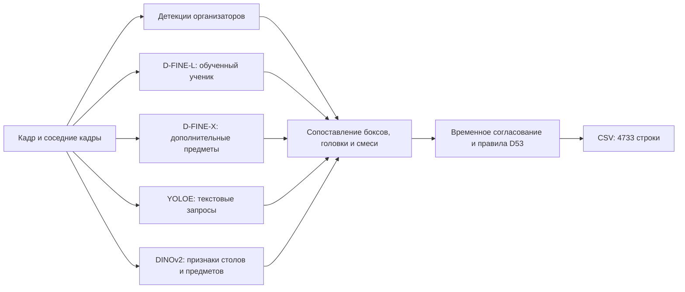

# CountsRuinsDetection

Материалы проверены 15 ноября 2026: все семь файлов `D53_legacy_weights.zip` совпадают с манифестом. В `D53_jury_run.zip` найден `final_d53_cpu_inputs.zip`, его SHA-256 совпадает с эталоном; `d41/embeddings_cuda.npz` присутствует. Старый `final_d53_inputs.zip` не заменяет CPU-архив. Архивы хранятся отдельно от Git.

Оценка занятости и видимого содержимого столов в кафе по кадрам камеры.

Репозиторий оформляет финальное решение команды **D53**. Его опубликованный командой результат Kaggle Public — **0.72201**. Источник зафиксирован на коммите [`00b6fb3`](https://github.com/PechenegHUB/Counts_ruins/tree/00b6fb3188f72ddebe1e297cf0e3ea6e0c5c67e2).

**Текущий статус:** здесь есть проверка артефактов, валидация CSV, расчёт метрики и запуск эталонной CPU-сборки через закреплённый старый код. Полный инференс нейросетей и обучение ещё не перенесены в этот репозиторий. Их рецепт и необходимые материалы описаны ниже; несуществующие команды запуска не выдаются за готовые.

## Что получает и выдаёт система

Вход: изображения, заданные рамки столов, контекстные кадры и предоставленные организаторами детекции. Одна строка результата соответствует одной заданной рамке стола на целевом кадре.

```csv
row_id,people,hands,cups,dishes,items,occ_prob
example,2,3,1,2,0,0.94
```

| Поле | Значение |
|---|---|
| `people` | Люди за столом или непосредственно возле него, кроме прохожих |
| `hands` | Отдельные видимые голые кисти над столешницей |
| `cups` | Чашки, кружки и стаканы; без бутылок, банок и ваз |
| `dishes` | Тарелки, миски и подносы, каждый отдельно |
| `items` | Личные вещи на столешнице; ноутбуки, планшеты и декор исключаются |
| `occ_prob` | Вероятность занятости; в метрике оценивается ранжирование |

Счётчики могут быть дробными, конечными, в диапазоне `[0,50]`; вероятность — `[0,1]`. Все ID шаблона должны присутствовать ровно один раз. `table_id` действует внутри кадра, а не является постоянным ID мебели. Полные правила подсчёта — в исходном задании организаторов.

## Как работает D53



Это архитектура исходного решения. В режиме CPU-воспроизведения нейросетевые выходы уже находятся в кэше.

| Компонент | Роль в финальном прогнозе |
|---|---|
| Ученик D-FINE-L, EXP-044 | Основные `people`, `hands`, `dishes`; также боксы для последующих проверок. Для людей/посуды используется медиана целевого и двух соседних кадров, руки считаются по целевому. |
| D-FINE-X Objects365 | Дополнительные предложения предметов и подтверждение чашек. Clean-счёт участвует в смеси `items`. |
| YOLOE-26m-seg | Детекции по текстовым запросам: признаки EXP-016 и дополнительное подтверждение чашек. |
| DINOv2 Small | Замороженные признаки для Ridge и логистических проверяющих голов чашек/слабых вещей. |
| D4 / D21 / D42 / D48 | Поправки количества вещей и чашек, подтверждение предложений, округление счётчиков. |
| D45 / D50 | Согласование чашек по соседним кадрам; поправка odds занятости ×2 или ×0.5 по наличию людей. |

Руки ограничиваются `hands ≤ 2 × people`. D53 не является одной нейросетью; это комбинация детекторов, небольших обучаемых голов и правил. [Подробности этапов](docs/pipeline.md).

## Три разных сценария запуска

| Сценарий | Статус здесь | Что нужно |
|---|---|---|
| Проверить CSV или артефакты | Реализовано | Python, шаблон CSV или манифест |
| Повторить D53 из кэшей | Есть запуск закреплённого исходного кода; полный запуск в новом репозитории ещё не повторён | Данные, внешний CPU-архив, старый репозиторий в точном коммите, CPU-зависимости |
| Получить прогноз из изображений и весов | Перенос предстоит | Все модели, восстановленные этапы инференса и обученные головы |
| Обучить модели | Перенос и проверка команд предстоят | Исходные данные, псевдоразметка, ручная разметка, начальные веса и GPU-окружение |

Проверенная командой CPU-сборка исходного решения и новый запускатель — не одно и то же. Здесь не заявляется повторная проверка полной сборки без внешнего архива.

## Установка

Для эталонной CPU-сборки используйте **Python 3.10**, как в исходном протоколе. Базовые утилиты не требуют PyTorch, CUDA или Transformers.

```powershell
git clone https://github.com/PechenegHUB/CountsRuinsDetection.git
cd CountsRuinsDetection
py -3.10 -m venv .venv
.venv\Scripts\python.exe -m pip install -e .
.venv\Scripts\python.exe -m countsruins --help
```

Команды ниже выполняются из корня репозитория. На другой ОС используйте Python из созданного окружения вместо Windows-пути `.venv\Scripts\python.exe`.

## Данные и материалы

Разместите полный распакованный пакет организаторов в `data/organizer/`. В этой папке должны находиться CSV и изображения, на которые они ссылаются. Например:

```text
data/organizer/
├── frames.csv
├── targets.csv
├── tables.csv
├── detections.csv
├── train_labels.csv
├── sample_submission.csv
├── aux_frames.csv
├── aux_boxes.csv
├── ... изображения кадров и контекста ...
└── ... вспомогательные .py из исходного пакета ...
```

Для CPU-сборки нужен архив **`final_d53_cpu_inputs.zip`** от команды. Для полного инференса нужны веса из **`D53_legacy_weights.zip`**. В GitHub эти архивы не включены; публичной ссылки на их скачивание в данном репозитории пока нет. SHA-256 обоих архивов находится в [manifests/bundles.json](manifests/bundles.json).

Необходимые нейросетевые файлы:

| Файл внутри пакета весов | Назначение | Размер |
|---|---|---:|
| `exp044/last.pth` | Обученный ученик; для инференса используется `ema.module` | 499.7 MB |
| `dfine/dfine_x_obj365.pth` | Замороженный D-FINE-X | 254.5 MB |
| `dfine/dfine_l_obj365_e25.pth` | Начальные веса для обучения ученика | 128.4 MB |
| `yoloe/yoloe-26m-seg.pt` | YOLOE | 70.4 MB |
| `yoloe/mobileclip2_b.ts` | Текстовый энкодер YOLOE | 253.8 MB |
| `dinov2/model.safetensors` + `dinov2/config.json` | DINOv2 Small | 88.3 MB |

Точные байты и хэши — в [manifests/weights.json](manifests/weights.json). Для CPU-сборки эти нейросетевые веса не нужны: используются замороженные выходы и признаки. Малые головы D14/D42/D48 в эталонной сборке заново обучаются на фиксированных train-признаках и разметке.

Проверить полученные файлы:

```powershell
.venv\Scripts\python.exe -m countsruins check-assets --root artifacts/weights --manifest manifests/weights.json
.venv\Scripts\python.exe -m countsruins check-assets --root artifacts/bundles --manifest manifests/bundles.json --only final_d53_cpu_inputs.zip
```

Проверка ничего не скачивает и не изменяет; отсутствие или несовпадение файла даёт ненулевой код выхода. [Полный список материалов для передачи](ASSETS_REQUIRED.md).

## Получить эталонный CSV из кэшей

1. Получите `final_d53_cpu_inputs.zip` и положите его в `artifacts/bundles/`.
2. Подготовьте `data/organizer/`.
3. Скачайте исходный код и переключитесь на закреплённый коммит:

```powershell
git clone https://github.com/PechenegHUB/Counts_ruins.git artifacts/legacy/Counts_ruins
git -C artifacts/legacy/Counts_ruins checkout --detach 00b6fb3188f72ddebe1e297cf0e3ea6e0c5c67e2
.venv\Scripts\python.exe -m pip install -r requirements/cached.txt
```

4. Запустите сборку в **новой, ещё не существующей** рабочей папке:

```powershell
.venv\Scripts\python.exe -m countsruins reproduce-cached --legacy-repo artifacts/legacy/Counts_ruins --data data/organizer --bundle artifacts/bundles/final_d53_cpu_inputs.zip --work artifacts/runs/d53
```

Результат: `artifacts/runs/d53/d53/submission_d53.csv`.

Запускатель проверяет коммит исходников, чистоту отслеживаемых файлов, SHA архива, затем вызывает старую сборку. Она переобучает малые головы, собирает промежуточные CSV и сверяет их хэши. После завершения дополнительно проверяются итоговый CSV, его SHA и 4733 строки.

Эталонный SHA-256 результата:

```text
09e4c960a562d611a98cedf926773841bc90d3bd556a80872250ce99ac7ccfa0
```

Флаг `--dry-run` проверяет входы и печатает команду, **не выполняя сборку**. GPU и скачивание нейросетевых весов этому режиму не нужны. Зависимость от старого репозитория пока явная: код D53 ещё не перенесён в новый пакет.

## Обучение моделей

Полной проверенной команды обучения из этого репозитория пока нет. Ниже — известный рецепт исходного решения, а не обещание готового нового launch-скрипта.

1. **Подготовить данные.** Кропы из официального пакета и aux, автоматически сформированные псевдобоксы, соответствия соседних кадров. Селектор изображений исходного генератора — строки `tables.csv` и aux-столы.
2. **Получить псевдоразметку.** Production-детекции, D-FINE-X и временные подтверждения переводятся в пять классов: `person`, `hand`, `cup`, `dish`, `item`. Исходный корпус содержит 5226 кропов640×640. Выход генератора: `images/`, `train.json`, `val.json`, `stats.json`.
3. **Обучить ученика D-FINE-L.** Начальные веса `dfine_l_obj365_e25.pth`, 12 эпох, batch8, AMP, EMA0.998, seed0. В исходном запуске использовалась RTX5070. Остальные параметры наследуются из конфигурации D-FINE и должны переноситься вместе с ней.
4. **Извлечь замороженные признаки DINOv2.** Отдельно для кропов столов и проверяемых объектных боксов.
5. **Обучить небольшие головы.** Ridge EXP-010/016, проверку чашек D14, слабых вещей D42/D48 с соответствующей разметкой и точными списками признаков.
6. **Оценить по датам.** Обучение на25 октября, проверка на26 октября, затем обратный срез; не смешивать соседние размеченные эпизоды. Псевдо-`val.json` исходного генератора не является независимой оценкой качества счётчиков.

Проверенные исходники рецепта: [генератор псевдометок](https://github.com/PechenegHUB/Counts_ruins/blob/00b6fb3188f72ddebe1e297cf0e3ea6e0c5c67e2/samir/pseudo_dataset.py), [обучение ученика](https://github.com/PechenegHUB/Counts_ruins/blob/00b6fb3188f72ddebe1e297cf0e3ea6e0c5c67e2/samir/train_student.py), [его конфиг](https://github.com/PechenegHUB/Counts_ruins/blob/00b6fb3188f72ddebe1e297cf0e3ea6e0c5c67e2/samir/student_cafe_l.yml). В них есть старые пути и внешние зависимости, поэтому их нужно адаптировать и проверить, прежде чем объявлять обучение здесь рабочим. [Подробный план обучения](docs/training.md).

Веса и обучение с нуля не гарантируют побитовое совпадение с исходным checkpoint. Для точной проверки существующего D53 используется зафиксированный архив кэшей.

## Предсказание из изображений

Последовательность: детекции организаторов → ученик и дополнительные детекторы → DINOv2-признаки → малые головы → привязка к столам и согласование соседних кадров → сборка D53.

**Единой рабочей команды `predict` в этом репозитории пока нет.** Её добавим после переноса и проверки всех этих этапов; сейчас получить эталонный CSV можно описанной выше сборкой из кэшей.

## Проверить и оценить CSV

```powershell
.venv\Scripts\python.exe -m countsruins validate artifacts/runs/d53/d53/submission_d53.csv --sample data/organizer/sample_submission.csv
.venv\Scripts\python.exe -m countsruins score labels.csv predictions.csv
```

`score` — независимая реализация формулы организаторов: `0.2 × AP + 0.8 × mean(max(0,1−WAPE))`. Поддерживаются совпадающие вероятности, нулевые классы и `Usage=Ignored`. Для оценки нужны настоящие метки; один шаблон submission их не заменяет.

## Результаты и ограничения

| Оценка исходного D53 | Результат |
|---|---:|
| Kaggle Public, сообщён командой | **0.72201** |
| Ручная разметка,25→26 /26→25 | 0.785166 /0.798405 |
| Официальная разметка,25→26 /26→25 | 0.690667 /0.799766 |

Это результаты исходного проекта, не нового обучения в этом репозитории. Обе даты неоднократно использовались при выборе решений: локальная оценка диагностическая. D42 имел тот же отображаемый Public; локальные поправки D53 не дали видимого прироста на Public.

Время полного инференса всех нейросетей не зафиксировано подтверждённым замером. Оценки из переписки не используются здесь как бенчмарк. [Протокол результатов](docs/results.md).

## Структура и проверка кода

```text
src/countsruins/     CLI, проверка артефактов, CSV/метрика, запуск эталона
configs/            Документированные конфигурации; reference-only помечены
manifests/          Источники, версии, SHA весов, архивов и эталонных CSV
requirements/       Зафиксированные CPU-зависимости исходной сборки
scripts/            Дополнительная точка запуска CPU-сборки
tests/              Проверки утилит на синтетических данных
docs/               Подробности пайплайна, обучения и воспроизведения
data/               Локальный пакет организаторов; содержимое вне Git
artifacts/          Локальные веса, архивы, кэши и результаты; вне Git
```

```powershell
.venv\Scripts\python.exe -m unittest discover -s tests -v
```

Статусы проверки нового кода — в [docs/verification.md](docs/verification.md). Лицензии и происхождение сторонних компонентов — в [THIRD_PARTY.md](THIRD_PARTY.md). Мы не публикуем исходные изображения, веса, приватные кэши или построчные результаты в Git.
